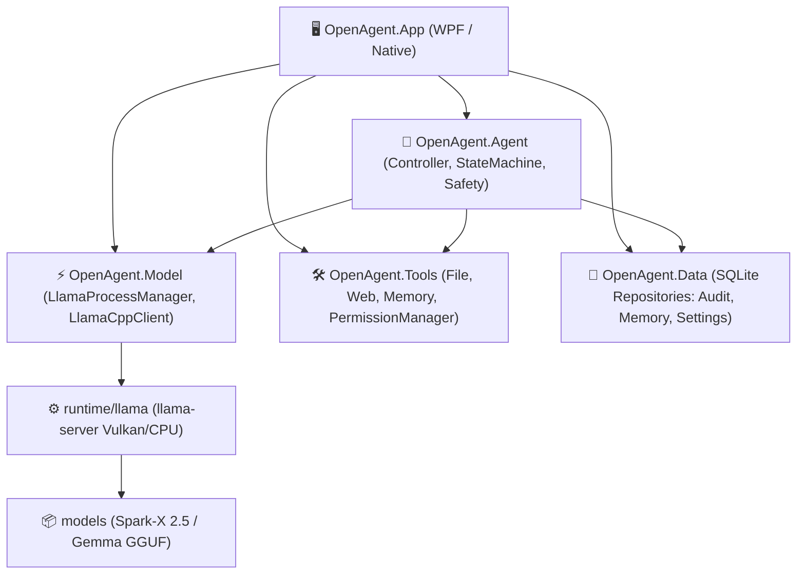

# 📚 OpenAgent — Documentazione di Sviluppo

Benvenuto nella documentazione tecnica e di sviluppo di **OpenAgent**, l'assistente desktop AI locale progettato per Windows con architettura zero-bloat, sandboxing rigido dei tool e inferenza locale on-device tramite `llama.cpp`.

---

## 📑 Indice dei Documenti

I file di pianificazione e roadmap di sviluppo sono archiviati in questa cartella:

1. **[Piano Tecnico e Sintesi Architetturale](desktop_ai_assistant.plan.md)** (`desktop_ai_assistant.plan.md`)  
   Specifica dettagliata dei vincoli di runtime, dello stack tecnologico scelto (C# WPF vs Rust/Electron), del loop decisionale dell'agente e dei criteri di valutazione.
2. **[Piano di Sviluppo Agile & Sprint](plan_agile_openagent.md)** (`plan_agile_openagent.md`)  
   Roadmap completa degli sprint (Sprint 0–5), budget di memoria su target 8 GB RAM / iGPU Vega 10, scelte di stile (pixel-art low-FPS) e checklist di validazione.

---

## 🏗️ Architettura dei Componenti

Il software è organizzato in una soluzione modulare multi-progetto .NET 8 (`OpenAgent.sln`):



### Dettaglio Progetti

| Progetto | Ruolo Principale |
| :--- | :--- |
| **`src/OpenAgent.App`** | Shell WPF moderna Fluent-style (mascotte pixel-art, overlay trasparente, fumetto su richiesta, input vocale Whisper locale con `VoiceInputService`, hotkeys globali `Ctrl+Spazio` e `Ctrl+Shift+V`, tray icon e pannello Impostazioni). |
| **`src/OpenAgent.Agent`** | Coordinatore del loop multi-step (`AgentController`), routing euristico dei task (`ModelTaskRouter`), tracker anti-loop (`SemanticCallTracker`), state machine reattiva (`AgentStateMachine`) e policy di escalation cloud. |
| **`src/OpenAgent.Model`** | Ciclo di vita del processo `llama-server.exe` tramite **Win32 Job Object** (`LlamaProcessManager`), client locale OpenAI-compatible (`LlamaCppClient`) e client cloud ibrido (`GeminiClient` con fallback resiliente). |
| **`src/OpenAgent.Tools`** | Tool sandboxati con livelli di rischio (`Read`, `Modify`, `Destructive`), validazione schemi JSON, allowlist percorsi e prompt di conferma (`PermissionManager`). |
| **`src/OpenAgent.Data`** | Persistenza dati con SQLite (`Microsoft.Data.Sqlite`): audit trail (`SqliteAuditRepository`), memoria persistente e configurazione (`SqliteUserSettingsRepository`), rilevamento specifiche e profilazione automatica (`HardwareDetector`, `HardwareProfiler`). |

---

## 🛡️ Modello di Sicurezza e Permessi

OpenAgent adotta il principio del minimo privilegio (**Zero Trust Sandbox**):

1. **Classificazione dei Tool:**
   - **`Read`** (`list_directory`, `read_file`, `web_search_or_fetch`, `recall_user_memory`): Esecuzione autonoma entro i percorsi consentiti dall'allowlist.
   - **`Modify`** (`move_or_rename`, `remember_user_preference`): Richiede conferma esplicita dell'utente tramite interfaccia grafica o policy definita.
   - **`Destructive`**: Sempre bloccato o sottoposto a doppia conferma con veto assoluto su file di sistema (`C:\Windows`, `C:\Program Files`, ecc.).
2. **Allowlist Dinamica:**
   - Percorsi predefiniti: `Documents`, `Downloads`, `Desktop`, directory del Workspace.
   - Gestibile e persistita a runtime dall'utente tramite il pannello Impostazioni.
3. **Audit Trail Completo:**
   - Ogni singola invocazione di tool viene registrata su database SQLite (`data/openagent_data.db`), comprensiva di timestamp, SessionId, argomenti JSON, esito e anteprima del risultato.

---

## 🧪 Suite di Test

Tutti i test del progetto sono posizionati nella cartella **`tests/`**.  
Per eseguire l'intera suite di test automatizzati con PowerShell 7:

```powershell
pwsh -File tests/run_all_tests.ps1
```

Per maggiori dettagli sui singoli test, consultare **[`tests/README.md`](../tests/README.md)**.

---

## 🚀 Compilazione e Rilascio

- **Eseguibile in Root (`OpenAgent.exe`):**  
  Compilato come singolo binario autonomo pronto all'uso con dipendenze SQLite native incluse.
- **Script di Release (`build_release.ps1`):**  
  Genera la directory distribuibile `dist/OpenAgent_v1.0` e il pacchetto compresso `dist/OpenAgent_v1.0_win-x64.zip`.
