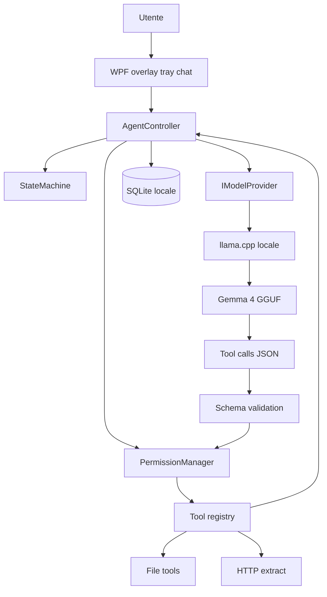

# Assistente desktop locale (sintesi chatppt + gemini)

## Cosa tenere da ciascun documento

I due testi descrivono lo stesso prodotto: overlay Windows, Gemma 4 locale, function calling, niente Tamagotchi. Differiscono su stack, budget RAM e profondità di prodotto.

**Da [chatppt.md](chatppt.md) (scheletro di prodotto)**

- Separazione obbligatoria: LLM → schema → permessi → esecuzione tool (mai accesso OS diretto).
- Livelli READ / MODIFY / DESTRUCTIVE e allowlist path.
- Registry tool (`ITool`), loop agente con timeout, cancel, retry, loop detection, audit.
- Persistenza SQLite (impostazioni, cronologia, log tool).
- `IModelProvider` per non accoppiare l’app a un solo backend.
- Roadmap a fasi e criteri di valutazione (affidabilità agente > feature).

**Da [gemini.md](gemini.md) (vincoli runtime)**

- Zero Chromium/Electron in idle; Playwright solo se e quando serve (non in MVP).
- Inference: **llama.cpp** (GGUF), non un runtime Python permanente.
- Idle: niente polling; risveglio da hotkey / click / drop file.
- Sprite a basso FPS in idle; HTTP+parser HTML prima di un browser reale.
- UX: drag-and-drop sul personaggio, click-through on-demand, fumetto/chat on-demand.

**Scelta stack (tua):** C# / .NET + WPF, non Rust. La RAM extra della shell (~200–300 MB vs ~30 MB) è irrilevante rispetto al modello; su Windows WPF vince per tray, finestra trasparente, hotkey, conferme e settings.

**Hardware (tua):** iGPU / CPU / non-NVIDIA. Profilo modello di default: **Gemma 4 E2B o E4B quantizzato (Q4/Q5)**, context 4k–8k. 12B solo come profilo opzionale se la macchina lo regge senza far lagare Windows. Backend llama.cpp: **Vulkan** (iGPU AMD/Intel) e **CPU** come fallback; DirectML solo se i benchmark lo giustificano. CUDA non è il path primario.

## Architettura da realizzare

Un processo **OpenAgent.exe** (WPF) + un processo **llama-server** avviato/fermato dall’app (stesso pattern di gemini: HTTP `127.0.0.1`, nessun Python fisso).

| Layer       | Tecnologia                                            | Note                                                               |
| ----------- | ----------------------------------------------------- | ------------------------------------------------------------------ |
| UI          | WPF, finestra borderless + `AllowsTransparency`, tray | Chat e pannello attività on-demand; personaggio opzionale          |
| Agent       | C# async, state machine, registry `ITool`             | Loop bounded; cancel/timeout                                       |
| Permessi    | Allowlist directory + conferme UI                     | Destructive sempre confermato                                      |
| Modello     | `GemmaLlamaCppProvider : IModelProvider`              | OpenAI-compatible o native llama.cpp `/completion` + tools Gemma 4 |
| Persistenza | SQLite                                                | Niente vector DB in MVP                                            |
| Web         | `HttpClient` + parser HTML                            | Nessun Playwright in V0.x                                          |

**Stati visivi (compromesso):** partire dal set piccolo di gemini (`Idle`, `Thinking`, `ToolActive`, `Speaking`, `Success`, `Error`, `Paused`) e mappare internamente i sotto-stati di chatppt (`Planning`, `WaitingTool`, `Observing`) come metadata/log, non come 11 animazioni distinte.

**Tool MVP (ibrido):** superficie stretta di gemini, contratto e sicurezza di chatppt.

- File: `list_directory`, `search_files`, `read_file` (cap a byte), `move_or_rename`, `copy_file`; write/delete solo con conferma.
- Web: `fetch_url` + estrazione testo; ricerca HTML (es. DuckDuckGo Lite) se serve retrieval.
- Niente shell arbitraria.

**Politica path default:** `Documents`, `Downloads`, workspace assistente; deny `Windows`, `Program Files`, store credenziali.

**Budget (realistici, non slogan):**

- Shell idle: target < 300 MB, CPU vicino a zero (WPF, animazione 2–4 FPS).
- llama.cpp: quasi tutta la RAM/VRAM disponibile, ma Windows deve restare usabile.
- Context dinamico 4096–8192 per non far esplodere la KV cache su CPU.

## Fasi di implementazione

Allineate a chatppt, con i vincoli sprint di gemini.

1. **V0.1 Shell + modello** — progetto .NET, overlay, tray, chat, state machine, avvio `llama-server`, provider Gemma 4, un round-trip testuale. Nessun tool ancora.
2. **V0.2 File + permessi** — registry tool, allowlist, conferme, SQLite audit, drag-and-drop path sul personaggio.
3. **V0.3 Web leggero** — GET + extract + limiti size/timeout/domain; indicazione visiva quando si esce in rete.
4. **V0.4 Agent loop** — catene multi-step con bound, retry, cancel, loop detection (es. “trova PDF, rinomina, sposta”).
5. **V1.0** — profili modello (E2B/E4B/CPU threads/Vulkan), memory esplicita (preferenze/path), installer, autostart, settings, animazioni rifinite.

Fuori scope (entrambi i doc): Tamagotchi, shell libera, cloud obbligatorio, Electron, browser sempre acceso.

## Rischi da validare subito (prima di troppa UI)

- Qualità **function calling Gemma 4** sul quantizzato E2B/E4B via llama.cpp (è il rischio n.1).
- Latenza e token/s su **CPU/iGPU** con context 4k: se troppo lenti, ridurre default a E2B + context 4k.
- Finestra WPF trasparente + always-on-top + click-through: prototipo di 1 giorno, è un classico punto di attrito Win32.

## Struttura repo prevista (quando si implementa)

- `src/OpenAgent.App` — WPF
- `src/OpenAgent.Agent` — loop, stato, permessi
- `src/OpenAgent.Tools` — file/web
- `src/OpenAgent.Model` — `IModelProvider` + llama.cpp
- `src/OpenAgent.Data` — SQLite
- `runtime/llama/` — binari llama.cpp (non committare i pesi GGUF)

